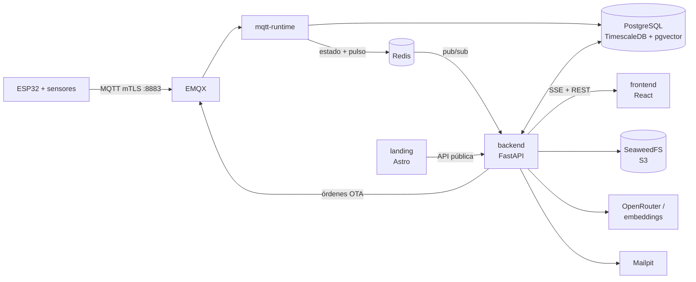

<p align="center">
  <picture>
    <source media="(prefers-color-scheme: dark)" srcset="docs/monitoreo_ambiental_blanco.png">
    
  </picture>
</p>

<h1 align="center">Monitoreo Ambiental IoT</h1>

<p align="center">
  Del sensor al dashboard: temperatura, humedad y presión en tiempo real.
</p>

---

🎓 **Monitoreo Ambiental IoT** es una plataforma IoT completa de monitoreo
ambiental. Dispositivos ESP32 con sensores DHT11, DHT22, BMP280 o BME280
publican sus lecturas por MQTT con TLS mutuo (mTLS); un backend en FastAPI las
guarda en PostgreSQL con TimescaleDB, mantiene el estado en vivo en Redis y las
muestra en un dashboard React que se actualiza en tiempo real. Suma
almacenamiento de objetos S3, actualizaciones de firmware OTA y un asistente
de IA que responde preguntas sobre los datos y sobre documentos.

Es el proyecto base de la materia **Arquitectura de Datos** de la Carrera de
Especialización en Internet de las Cosas (CEIoT). La presentación de la clase 8
("La vida de un dato") recorre cómo este repositorio aplica cada técnica: está
en [`clase-08/practica`](https://github.com/martinlacheski/ceiot-arquitectura-datos/tree/main/clase-08/practica)
del [repositorio de la materia](https://github.com/martinlacheski/ceiot-arquitectura-datos).

---

## 🧪 Características

- **Dashboard en tiempo real**: cada lectura dispara un aviso por SSE y el
  navegador parchea su caché (TanStack Query) sin recargar la página.
- **Lecturas agregadas**: por rango de fechas y nivel de agregación
  (automático o elegido), con el promedio y la banda mín–máx de cada serie.
- **Establecimientos y mapa**: dispositivos agrupados por establecimiento, con
  su ubicación en el mapa.
- **Invitados con alcance**: acceso a un establecimiento o a un solo
  dispositivo, y únicamente a los datos posteriores al inicio de su acceso.
- **Historial de dispositivos**: incluye los equipos que ya dejaron un
  establecimiento, con el nombre que tenían ahí.
- **Asistente de IA**: preguntas sobre los datos (text-to-SQL) y sobre
  documentos PDF, TXT, MD o DOCX cargados por un administrador (RAG); un
  enrutador decide qué camino usar.
- **Firmware OTA**: publicación de versiones y actualización de los equipos;
  el dispositivo verifica SHA-256 y tamaño antes de instalar.
- **Aprovisionamiento**: alta de cada ESP32 con su propio certificado de
  cliente, y un emulador para probar sin hardware.
- **Backups verificados**: cada backup se restaura en un contenedor descartable
  y se compara contra su manifiesto; se puede programar con cron.
- **Landing pública** en español, portugués e inglés, con mapa de
  establecimientos y formulario de contacto.

---

## 🗄️ Arquitectura de datos

Cada técnica de la materia tiene un lugar concreto en el código:

| Técnica | Cómo se aplica | Dónde mirar |
| --- | --- | --- |
| Series de tiempo | Hypertable de telemetría en TimescaleDB, `time_bucket` para agregar, compresión a los 7 días, retención de 1 año y agregado continuo `telemetry_hourly` | [`docs/ciclo-de-vida-datos.md`](docs/ciclo-de-vida-datos.md) |
| NoSQL | Valores de cada lectura en JSONB con índice GIN; archivos en SeaweedFS (S3); presencia del dispositivo con mensaje MQTT retenido y Last Will | [`0005_environmental_sensor_model.py`](backend/alembic/versions/0005_environmental_sensor_model.py), [`seaweedfs/README.md`](seaweedfs/README.md), [`esp32/README.md`](esp32/README.md) |
| Base en memoria | Redis guarda el último estado de cada dispositivo, publica el pulso que alimenta el SSE (pub/sub) y cuenta el límite de preguntas del asistente; si se cae, la app sigue con la base | [`backend/app/core/live.py`](backend/app/core/live.py) |
| Seguridad en la base | Row Level Security con tres roles (`iot_app_admin`, `iot_app`, `ai_readonly`) y vistas `security_barrier` sobre la telemetría | [`docs/roles-base-de-datos.md`](docs/roles-base-de-datos.md) |
| Text-to-SQL | Guardia con `sqlglot` (un único `SELECT` sobre una vista `ai_read`, con lista blanca y `LIMIT`), ejecutado en una transacción de solo lectura como `ai_readonly` y con la identidad RLS de quien pregunta | [`sql_guard.py`](backend/app/api/assistant/sql_guard.py), [`sql_executor.py`](backend/app/api/assistant/sql_executor.py) |
| RAG | Fragmentos con embeddings `BAAI/bge-m3` (1024 dimensiones) en pgvector, índice HNSW por distancia coseno; embeddings por OpenRouter o locales | [`0014_rag_document_chunks.py`](backend/alembic/versions/0014_rag_document_chunks.py), [`embeddings/README.md`](embeddings/README.md) |
| Backups verificados | `pg_dump` sobre un snapshot, roles y objetos S3, con manifiesto y restauración de prueba | [`docs/backups.md`](docs/backups.md) |
| Seguridad del transporte | CA propia, certificado por dispositivo y mTLS en EMQX | [`docs/certificados-mqtt.md`](docs/certificados-mqtt.md) |

---

## 🏗️ Arquitectura



Una lectura viaja así: el ESP32 la publica en EMQX, `mqtt-runtime` la guarda
en la base y actualiza Redis, Redis avisa al backend y el backend se lo
reenvía al navegador por SSE.

---

## ⚙️ Tecnologías

- **Firmware**: C sobre ESP-IDF 6.1 (ESP32 clásico).
- **Mensajería**: EMQX 5.8 con mTLS.
- **Backend**: Python 3.12, FastAPI, SQLAlchemy/SQLModel, Alembic.
- **Base de datos**: PostgreSQL 16 con TimescaleDB 2.30 y pgvector.
- **Memoria y objetos**: Redis 7 y SeaweedFS (API S3).
- **Frontend**: React 19, Vite, TanStack Query, Recharts, Tailwind CSS y
  componentes shadcn/ui (Radix).
- **Landing**: Astro.
- **IA**: OpenRouter (modelo de chat y embeddings) o embeddings locales con
  Text Embeddings Inference.
- **Infraestructura**: Docker Compose, Mailpit, pgAdmin y RedisInsight.

---

## 🚀 Inicio rápido

Necesitás Docker con Compose 2.24 o superior, `bash` y `openssl`.

1. **Cloná el repositorio**:

   ```bash
   git clone https://github.com/martinlacheski/ceiot-app-base.git
   cd ceiot-app-base
   ```

2. **Creá los archivos de configuración** y completá los valores marcados con
   `CAMBIAR_` ([qué poner en cada uno](docs/puesta-en-marcha.md#2-archivos-de-configuración)):

   ```bash
   for c in backend frontend landing timescaledb mqtt; do cp $c/.env.example $c/.env; done
   ```

3. **Generá los certificados del broker**:

   ```bash
   mqtt/pki/crear-ca.sh
   mqtt/pki/emitir-certificado-broker.sh
   ```

4. **Levantá el stack** (aplica las migraciones antes de iniciar el backend):

   ```bash
   scripts/levantar.sh --build
   ```

5. **Ingresá** en <http://localhost:5173> con el administrador definido en
   `BOOTSTRAP_ADMIN_*` de `backend/.env`.

| Servicio | Dirección |
| --- | --- |
| Frontend | <http://localhost:5173> |
| Landing | <http://localhost:4321> |
| API (documentación interactiva) | <http://localhost:8000/api/docs> |
| Mailpit (correos de desarrollo) | <http://localhost:8025> |
| MQTT para dispositivos (mTLS) | `localhost:8883` |

📖 **Guía completa** (puertos, red local para ESP32 reales, correo, base de
datos, backups y cómo detener todo): [`docs/puesta-en-marcha.md`](docs/puesta-en-marcha.md).

---

## 📁 Estructura del proyecto

```text
ceiot-app-base/
├── backend/         # API FastAPI, mqtt-runtime, migraciones Alembic y tests
├── frontend/        # Aplicación web React (dashboard y administración)
├── landing/         # Sitio público en Astro (es, pt-BR, en)
├── esp32/           # Firmware ESP-IDF del dispositivo ambiental
├── firmwares/       # Imágenes de firmware publicadas para OTA (.bin + .sha256)
├── provisioning/    # Alta y grabación de dispositivos (serial, certificado, perfil)
├── mqtt/            # Broker EMQX y scripts de la PKI
├── timescaledb/     # PostgreSQL + TimescaleDB y creación del rol de la aplicación
├── redis/           # Redis para el estado en vivo
├── seaweedfs/       # Almacenamiento de objetos S3 (documentos y firmware)
├── embeddings/      # Embeddings locales opcionales (perfil embeddings-local)
├── mailpit/         # Captura de correos en desarrollo
├── pgadmin/         # Cliente web de PostgreSQL (desarrollo)
├── redisinsight/    # Cliente web de Redis (desarrollo)
├── scripts/         # Arranque, backups, cron y separación de roles
├── tools/           # Emulador de dispositivo y archivado de firmware
├── docs/            # Guías de operación y arquitectura de datos
└── docker-compose.yml
```

---

## 📚 Documentación

| Documento | Para qué sirve |
| --- | --- |
| [Puesta en marcha](docs/puesta-en-marcha.md) | Primer arranque paso a paso, puertos, red local, correo, base y backups |
| [Ciclo de vida de los datos](docs/ciclo-de-vida-datos.md) | Compresión, retención y agregado continuo de la telemetría |
| [Roles de la base de datos](docs/roles-base-de-datos.md) | Los tres roles, sus permisos y cómo separarlos en una instalación existente |
| [Certificados MQTT](docs/certificados-mqtt.md) | CA, certificado del broker y certificados de dispositivos |
| [Backups verificados](docs/backups.md) | Qué se respalda, cómo se verifica, cron y restauración |
| [Google OAuth](docs/configuracion-google-oauth.md) | Inicio de sesión con Google (opcional) |
| [Backend](backend/README.md) | Ejecución, correo, RAG sobre documentos y estructura de la API |
| [Firmware ESP32](esp32/README.md) | Compilación, tópicos MQTT, OTA y pruebas en el host |
| [Aprovisionamiento](provisioning/README.md) | Alta y grabación de un ESP32 real |
| [MQTT](mqtt/README.md) | Broker, PKI y CLI de emulación |
| [Versionado de firmware](firmwares/README.md) | Publicar una versión nueva y actualizar por OTA |

---

## ✅ Pruebas

| Componente | Comando |
| --- | --- |
| Backend (con el stack levantado) | `docker compose exec -T backend python -m pytest -q --ignore=tests/test_google_oauth.py` |
| Backend, grupo OAuth sin red | ver [Google OAuth](docs/configuracion-google-oauth.md#verificación-automática-sin-red) |
| Frontend | `cd frontend && npm ci && npx vitest run` |
| Landing | `cd landing && npm ci && npm test` |
| Scripts de backup y roles | `python3 -m unittest discover -s scripts/tests` |
| Aprovisionamiento | `python3 -m unittest discover -s provisioning/tests` |
| Firmware (en el host) | ver [Host tests](esp32/README.md#host-tests) |

---

## 📬 Contacto

- **Autor**: Martín Lacheski
- **GitHub**: [@martinlacheski](https://github.com/martinlacheski)

---

## 🔗 Recursos recomendados

- [TimescaleDB](https://docs.timescale.com/)
- [PostgreSQL: Row Security Policies](https://www.postgresql.org/docs/16/ddl-rowsecurity.html)
- [pgvector](https://github.com/pgvector/pgvector)
- [EMQX](https://docs.emqx.com/en/emqx/latest/)
- [FastAPI](https://fastapi.tiangolo.com/)
- [React](https://react.dev/)
- [Redis](https://redis.io/docs/latest/)
- [ESP-IDF](https://docs.espressif.com/projects/esp-idf/en/latest/esp32/)
